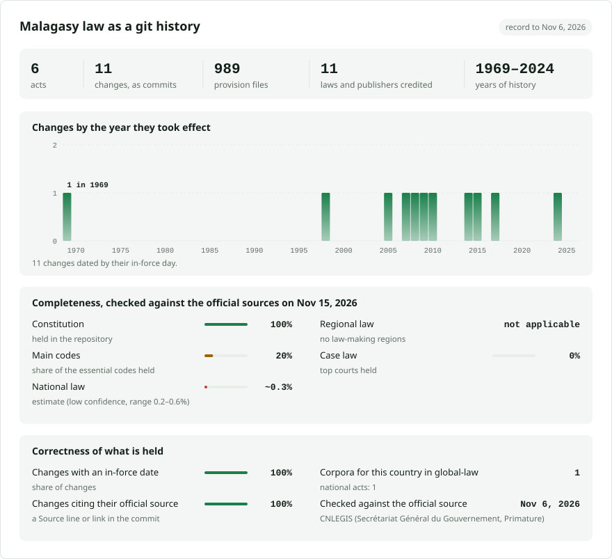

# Madagascar: law history in git

[Français](README.md) · **English**

<picture>
<source media="(prefers-color-scheme: dark)" srcset="data/effort-dark.svg">

</picture>

The law of Madagascar as a git history: one file per article, one commit per law on the day it took effect, and the law that made each change as the commit's author. `git blame` names the law behind every paragraph; `git log` lists every change to an article; picking a date gives the text in force that day.

Part of [lexifina/global-law](https://github.com/lexifina/global-law), one git history for every country's law: this is Madagascar's national law, which global-law reads at `madagascar/national/acts/`.

**What is in it now:** six acts, with 11 versions: the Constitution (4 versions, from the 1992 Constitution as revised in 1995 and 1998 to the Constitution of 11 December 2010), the Code du travail (Loi n° 2003-044, then the new code, Loi n° 2024-014), Loi n° 2014-006 on cybercrime (as enacted and as amended by Loi n° 2016-031), and, in one version each, Loi n° 2014-038 on personal data, Loi n° 2007-022 on marriage and matrimonial property, and Loi n° 68-012 on successions, wills and gifts. The `README.md` in each act's folder lists every provision; [`data/laws.csv`](data/laws.csv) lists the laws behind the versions.

Each act is a folder of article files: `constitution/`, `code-du-travail/`, `loi-2014-006/`, `loi-2014-038/`, `mariage-regimes-matrimoniaux/` and `successions-testaments-donations/` (`code-du-travail/art-002.md` is Article 2 of the Code du travail, who counts as a worker), with the headings in each folder's `structure.md`. A file holds the article of that number in the text in force: the 2007 revision renumbered the Constitution from article 57 on, and the 2010 Constitution and the 2024 Code du travail replaced whole texts, so across those versions a file can hold a different article.

The text is in French, as CNLEGIS and the Ministry of Justice publish it. The Malagasy text, also official, is not part of this record, nor is an English translation.

## Questions as git commands

| Question | Command |
| --- | --- |
| Every change to Article 2 of the Code du travail (who counts as a worker) | `git log -p --word-diff -- code-du-travail/art-002.md` |
| Which law wrote each line of Article 2? | `git blame code-du-travail/art-002.md` |
| Every version of Article 2, with the day each took effect | `git log --format="%h %(trailers:key=In-force,valueonly,separator=) %an" -- code-du-travail/art-002.md` |
| Article 2 as in force on 1 January 2020 | `python tools/on.py 2020-01-01 code-du-travail art-002` |

**Outside git**, we also host this record publicly, for free:

- **[Ask Claude about the law of Madagascar](https://global-law.lexifina.com/v1/try_claude?country=madagascar)**: opens Claude with a first question ready.
- **[Ask ChatGPT](https://global-law.lexifina.com/v1/try_chatgpt?country=madagascar)**: the same question in ChatGPT.
- **[Search the law of Madagascar on our site](https://lexifina.com/law?country=madagascar&q=cong%C3%A9+pay%C3%A9)**: a search for "congé payé" (paid leave), with each provision's text and its versions, no account needed.
- **[Developer REST API](https://global-law.lexifina.com/v1/search_law?query=cong%C3%A9+pay%C3%A9&jurisdiction=madagascar)**: the same search as JSON, with no key. See the [documentation here](https://lexifina.com/api/global-law).

Both assistants read the record through the free Global law connector (MCP, `https://global-law.lexifina.com/mcp`); the first time, the chat gives you the link that adds it. Ask in French or in English.

**Host it yourself easily.** All it takes is git and Python, and the tools run on your machine:

```sh
git clone --depth 1 https://github.com/lexifina/global-law && cd global-law
python3 tools/countries.py add madagascar/national/acts
python3 tools/law.py show 2026-01-01 madagascar/national/acts/code-du-travail/art-002.md
```

Opened in Claude Code, Cursor, VS Code or Codex, the clone also starts a local MCP server with the same tools ([MCP.md](https://github.com/lexifina/global-law/blob/main/MCP.md)).

## Dates

Each commit is dated at noon, Indian/Antananarivo, on the day the version took effect, and carries it in its `In-force:` trailer; the promulgation and Journal officiel days are in `Enacted:` and `Published:`.

- A law with no in-force clause binds "un jour franc après l'arrivée du Journal officiel" (Ordonnance n° 62-041 of 19 September 1962, art. 3). The arrival day is not printed, so such a law is dated the Journal officiel's date plus two days, the earliest possible: LC 98-001, Loi n° 2003-044, 2007-022, 2014-006, 2014-038, 2016-031 and 2024-014.
- LC 2007-001 and LC 2009-001 took effect "immédiatement" on broadcast or posting (art. 4 of the same Ordonnance); that day is not printed, so each is dated its promulgation day. The 2010 Constitution took effect on promulgation (art. 164), on 11 December 2010.
- Loi n° 68-012 took effect six months after its promulgation (art. 127), on 4 January 1969. Git cannot store dates before 1970, so its commit is dated 1 January 1970, with the real day in `In-force:`; ask for a date with `tools/on.py`, not `git log --before`.

Each change is credited to the law that made it, at an address that cannot exist (`loi-2016-031@cnlegis.invalid`); the committer is always Lexifina. The first Constitution version is credited to CNLEGIS as the oldest version available, since CNLEGIS has no usable text of the 1992 original or of LC 95-001.

## How it is checked

- `tools/check_repo.py` reads every version back from git on the day it took effect and on the day before, and both must match the corpus the history was built from; it also checks that there are no merge commits, that commit dates never go backwards, that nothing is dated in the future and that every commit's trailers parse. The results are in [`REPRODUCE.md`](REPRODUCE.md).
- CNLEGIS publishes no consolidated texts, so two versions are replayed from the amending law's own words: the Constitution in 2009 (article 15 as LC 2009-001 quotes it) and Loi n° 2014-006 in 2017 (article 20 as Loi n° 2016-031 quotes it). The build stops unless the amending law reads exactly as a single replacement.
- Loi n° 2024-014 is read from the text layer of the official PDF CNLEGIS links (no OCR), and its words are checked against the PDF.
- `tools/build.py` writes the history from the corpus in one pass, so the same corpus gives the same hashes; [`data/corpus.sha256`](data/corpus.sha256) gives the corpus's hash. A second build of the present corpus has not yet been compared.

## What it does not show

- **The Code pénal.** CNLEGIS publishes only its amending laws, not the code itself, and no official consolidated text with a text layer was found.
- **Later amendments to Loi n° 2007-022 and Loi n° 68-012**, which were not searched for: each is its text as published.
- **Earlier constitutional texts**: the 1992 Constitution as first enacted and LC 95-001 as versions of their own, and the constitutions of 1959 and 1975.
- **Changes that left the words alone**: Ordonnance n° 2009-001 of 17 March 2009, the 2009 Charte de la Transition and the events since October 2025. CNLEGIS still listed the 2010 Constitution as "En vigueur" on 28 October 2026.
- **Implementing decrees** (such as Décret n° 2023-1541 for Loi n° 2014-038) and decisions of the Haute Cour constitutionnelle.

## Sources

| Source | Kind | Past versions | Notes |
| --- | --- | --- | --- |
| [CNLEGIS](https://cnlegis.gov.mg) (Secrétariat Général du Gouvernement, Primature) | Official legal database: each act as enacted, in French HTML or the official PDF | no consolidated versions; its notes name the amending laws | The Constitution, the Code du travail, and Loi n° 2014-006, 2014-038 and 2016-031 |
| Ministère de la Justice (justice.gov.mg), "Textes sur la famille", as kept by the Internet Archive | The Ministry's copies of laws as published in the Journal officiel | no | Loi n° 2007-022 (Journal officiel n° 3163, 28 January 2008) and Loi n° 68-012 (n° 598, 13 July 1968) |

## Licence

See [`LICENSE`](LICENSE). The texts come from CNLEGIS and from the Ministry of Justice's copies; neither publishes terms of use, so their reuse terms are unclear. The scripts, the history's structure, the tables and the documentation are CC0 1.0.

No AI model wrote, translated or corrected legal text, and none runs when the history is built; the scripts were written by Claude Code running Claude Opus 5.5, with which the acts were chosen and their in-force days read from the official texts (see [`REPRODUCE.md`](REPRODUCE.md)).

## More

From [lexifina/global-law](https://github.com/lexifina/global-law):

- [FEATURES.md](https://github.com/lexifina/global-law/blob/main/FEATURES.md): every feature, and what every corpus must support (`git blame`, `law.py`, the MCP tools)
- [FAQ.md](https://github.com/lexifina/global-law/blob/main/FAQ.md): questions and answers · [CONTRIBUTING.md](https://github.com/lexifina/global-law/blob/main/CONTRIBUTING.md): proposing changes · [MCP.md](https://github.com/lexifina/global-law/blob/main/MCP.md): the MCP server · [REPRODUCE.md](https://github.com/lexifina/global-law/blob/main/REPRODUCE.md): how it was built · [CHANGELOG.md](https://github.com/lexifina/global-law/blob/main/CHANGELOG.md)
- [FRESHNESS.md](https://github.com/lexifina/global-law/blob/main/FRESHNESS.md): how current each corpus is · [Monitoring](https://github.com/lexifina/global-law/tree/main/monitoring): whether updates are running · [WATCHING.md](https://github.com/lexifina/global-law/blob/main/WATCHING.md): how each official source is watched for changes
- [performance/](https://github.com/lexifina/global-law/tree/main/performance): how fast the tools are, measured
- [visualisations/](https://github.com/lexifina/global-law/tree/main/visualisations): charts and bridges across the world's law
- [Vulnerabilities](https://github.com/lexifina/global-law/tree/main/vulnerabilities): mistakes in legislation as published
