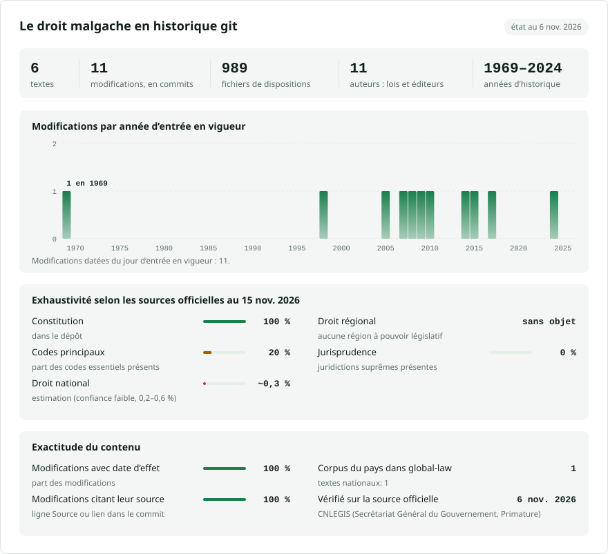

# Madagascar : l’histoire du droit dans git

**Français** · [English](README.en.md)

<picture>
<source media="(prefers-color-scheme: dark)" srcset="data/fr/effort-dark.svg">

</picture>

Le droit de Madagascar sous la forme d’un historique git : un fichier par article, un commit par loi à la date de son entrée en vigueur, et la loi auteur de chaque modification comme auteur du commit. `git blame` indique la loi à l’origine de chaque alinéa ; `git log` liste toutes les modifications d’un article ; le choix d’une date donne le texte en vigueur ce jour-là.

Fait partie de [lexifina/global-law](https://github.com/lexifina/global-law), un historique git unique pour le droit de tous les pays : il s’agit ici du droit national de Madagascar, que global-law lit sous `madagascar/national/acts/`.

**Contenu actuel :** 770 textes : la Constitution (4 versions, de 1998 à la Constitution du 11 décembre 2010), 17 codes (`code-du-travail`, `code-d-ethique-et-de-bonne-conduite-politique-des-acteurs`, `code-de-gestion-des-aires-protegees`, `code-de-l-artisanat` …), 648 lois, 104 ordonnances, 0 décrets et 0 arrêtés, entrés en vigueur entre 1960 et 2026, chacun tel que CNLEGIS le publie (une version), sauf la Constitution, le Code du travail et la loi n° 2014-006, dont les versions successives sont rejouées. [`corpus.json`](corpus.json) liste les textes ajoutés depuis CNLEGIS ; [`STRUCTURE.md`](STRUCTURE.md) décrit l’arborescence.

Chaque texte est un dossier de fichiers d’articles, rangé par nature et par année : `constitution/`, `codes/<code>/`, `lois/<année>/<numéro>-<objet>/`, `ordonnances/<année>/…`, `decrets/<année>/…` et `arretes/<année>/…` (`codes/code-du-travail/art-002.md` est l’article 2 du Code du travail, qui définit le travailleur), avec les visas dans `visas.md` et les intitulés dans le `structure.md` de chaque dossier. Un fichier contient l’article portant ce numéro dans le texte en vigueur : la révision de 2007 a renuméroté la Constitution à partir de l’article 57, et la Constitution de 2010 et le Code du travail de 2024 ont remplacé des textes entiers, de sorte que, d’une de ces versions à l’autre, un fichier peut contenir un article différent.

Le texte est en français, tel que le publient CNLEGIS et le Ministère de la Justice. Le texte malgache, également officiel, ne fait pas partie de ce corpus, pas plus qu’une traduction anglaise.

## Questions sous forme de commandes git

| Question | Commande |
| --- | --- |
| Toutes les modifications de l’article 2 du Code du travail (définition du travailleur) | `git log -p --word-diff -- codes/code-du-travail/art-002.md` |
| Quelle loi a rédigé chaque ligne de l’article 2 ? | `git blame codes/code-du-travail/art-002.md` |
| Toutes les versions de l’article 2, avec la date d’entrée en vigueur de chacune | `git log --format="%h %(trailers:key=In-force,valueonly,separator=) %an" -- codes/code-du-travail/art-002.md` |
| L’article 2 tel qu’en vigueur au 1er janvier 2020 | `python tools/on.py 2020-01-01 codes/code-du-travail art-002` |

**En dehors de git**, nous hébergeons aussi ce corpus publiquement, gratuitement :

- **[Interroger Claude sur le droit de Madagascar](https://global-law.lexifina.com/v1/try_claude?country=madagascar)** : ouvre Claude avec une première question prête.
- **[Interroger ChatGPT](https://global-law.lexifina.com/v1/try_chatgpt?country=madagascar)** : la même question dans ChatGPT.
- **[Rechercher dans le droit de Madagascar sur notre site](https://lexifina.com/law?country=madagascar&q=cong%C3%A9+pay%C3%A9)** : une recherche de « congé payé », avec le texte de chaque disposition et ses versions, sans compte.
- **[API REST pour développeurs](https://global-law.lexifina.com/v1/search_law?query=cong%C3%A9+pay%C3%A9&jurisdiction=madagascar)** : la même recherche au format JSON, sans clé. Voir la [documentation ici](https://lexifina.com/api/global-law).

Les deux assistants lisent le corpus au moyen du connecteur gratuit Global law (MCP, `https://global-law.lexifina.com/mcp`) ; la première fois, la conversation vous donne le lien qui l’ajoute. Posez vos questions en français ou en anglais.

**L’héberger vous-même, simplement.** Il suffit de git et de Python, et les outils s’exécutent sur votre machine :

```sh
git clone --depth 1 https://github.com/lexifina/global-law && cd global-law
python3 tools/countries.py add madagascar/national/acts
python3 tools/law.py show 2026-01-01 madagascar/national/acts/codes/code-du-travail/art-002.md
```

Ouvert dans Claude Code, Cursor, VS Code ou Codex, le clone démarre aussi un serveur MCP local doté des mêmes outils ([MCP.md](https://github.com/lexifina/global-law/blob/main/MCP.md)).

## Dates

Chaque commit est daté à midi, heure Indian/Antananarivo, du jour où la version est entrée en vigueur, et porte cette date dans son trailer `In-force:` ; les dates de promulgation et du Journal officiel figurent dans `Enacted:` et `Published:`.

- Une loi dépourvue de clause d’entrée en vigueur devient obligatoire « un jour franc après l'arrivée du Journal officiel » (ordonnance n° 62-041 du 19 septembre 1962, art. 3). La date d’arrivée n’étant pas imprimée, une telle loi est datée de la date du Journal officiel plus deux jours, la plus proche possible : LC 98-001, lois n° 2003-044, 2007-022, 2014-006, 2014-038, 2016-031 et 2024-014, ainsi que la plupart des textes ajoutés depuis CNLEGIS en novembre 2026 (date du Journal officiel relevée sur la fiche CNLEGIS). Un texte qui s’applique dès sa signature ou immédiatement (procédure d’urgence, art. 4) est daté du jour du texte ; un texte qui fixe sa propre date, de celle-ci. Le trailer `In-force-basis:` de chaque commit indique la règle appliquée ; un texte sans date de Journal officiel ni clause d’entrée en vigueur est écarté.
- La LC 2007-001 et la LC 2009-001 sont entrées en vigueur « immédiatement » par voie de radiodiffusion ou d’affichage (art. 4 de la même ordonnance) ; cette date n’étant pas imprimée, chacune est datée du jour de sa promulgation. La Constitution de 2010 est entrée en vigueur dès sa promulgation (art. 164), le 11 décembre 2010.
- La loi n° 68-012 est entrée en vigueur six mois après sa promulgation (art. 127), le 4 janvier 1969. Git ne pouvant enregistrer de dates antérieures à 1970, son commit est daté du 1er janvier 1970, la date réelle figurant dans `In-force:` ; interrogez une date avec `tools/on.py`, et non avec `git log --before`.

Chaque modification est attribuée à la loi qui l’a opérée, sous une adresse qui ne peut pas exister (`loi-2016-031@cnlegis.invalid`) ; le committer est toujours Lexifina. La première version de la Constitution est attribuée à CNLEGIS en tant que plus ancienne version disponible, CNLEGIS ne disposant d’aucun texte exploitable de l’original de 1992 ni de la LC 95-001.

## Méthode de vérification

- `tools/check_repo.py` relit chaque version dans git le jour de son entrée en vigueur et la veille, et les deux doivent correspondre au corpus à partir duquel l’historique a été construit ; il vérifie aussi l’absence de commits de fusion, que les dates des commits ne reculent jamais, qu’aucun commit n’est daté dans le futur et que les trailers de chaque commit sont analysables. Les résultats figurent dans [`REPRODUCE.md`](REPRODUCE.md).
- CNLEGIS ne publie aucun texte consolidé ; deux versions sont donc reconstituées à partir des termes mêmes de la loi modificative : la Constitution en 2009 (l’article 15 tel que le cite la LC 2009-001) et la loi n° 2014-006 en 2017 (l’article 20 tel que le cite la loi n° 2016-031). La construction s’arrête si la loi modificative ne se lit pas exactement comme un remplacement unique.
- La loi n° 2024-014 est lue à partir de la couche texte du PDF officiel vers lequel renvoie CNLEGIS (sans OCR), et ses termes sont vérifiés par rapport au PDF.
- `tools/build.py` écrit l’historique à partir du corpus en une seule passe, de sorte qu’un même corpus donne les mêmes empreintes ; [`data/corpus.sha256`](data/corpus.sha256) donne l’empreinte du corpus. Une seconde construction du corpus actuel n’a pas encore été comparée.
- [vulnerabilities/](vulnerabilities/): erreurs de rédaction possibles dans ce droit, trouvées par les détecteurs de global-law et vérifiées à la main. Pas encore lancé.

## Ce qu’il ne montre pas

- **Le Code pénal.** CNLEGIS ne publie que ses lois modificatives, et non le code lui-même, et aucun texte consolidé officiel doté d’une couche texte n’a été trouvé.
- **Les modifications ultérieures de la loi n° 2007-022 et de la loi n° 68-012**, qui n’ont pas été recherchées : chacune figure dans son texte tel que publié.
- **Les textes constitutionnels antérieurs** : la Constitution de 1992 dans sa version initiale et la LC 95-001 en tant que versions distinctes, ainsi que les constitutions de 1959 et de 1975.
- **Les changements qui n’ont pas modifié le texte** : l’ordonnance n° 2009-001 du 17 mars 2009, la Charte de la Transition de 2009 et les événements survenus depuis octobre 2025. CNLEGIS indiquait encore la Constitution de 2010 comme « En vigueur » le 28 octobre 2026.
- **Les textes publiés seulement en image** (65 textes de CNLEGIS : PDF numérisés sans couche texte ou à la couche texte illisible, faute d’OCR de notre part), ceux dont la date d’entrée en vigueur n’a pu être établie (12), les nominations et autres mesures individuelles, et les modifications ultérieures des textes ajoutés en novembre 2026 (chacun figure tel que publié). Les décisions de la Haute Cour constitutionnelle sont dans un dépôt distinct.

## Sources

| Source | Nature | Versions antérieures | Remarques |
| --- | --- | --- | --- |
| [CNLEGIS](https://cnlegis.gov.mg) (Secrétariat Général du Gouvernement, Primature) | Base de données juridique officielle : chaque texte tel qu’adopté, en HTML français ou en PDF officiel | aucune version consolidée ; ses notes indiquent les lois modificatives | La Constitution, les codes, lois, ordonnances, décrets et arrêtés (texte HTML ou couche texte du PDF officiel ; 3 textes sur la couche texte posée par l’éditeur sur un scan, signalés `Text-source: publisher OCR`) |
| Ministère de la Justice (justice.gov.mg), « Textes sur la famille », tels que conservés par l’Internet Archive | Copies, par le Ministère, de lois telles que publiées au Journal officiel | non | Loi n° 2007-022 (Journal officiel n° 3163, 28 janvier 2008) et loi n° 68-012 (n° 598, 13 juillet 1968) |

## Licence

Voir [`LICENSE`](LICENSE). Les textes proviennent de CNLEGIS et des copies du Ministère de la Justice ; aucun des deux ne publie de conditions d’utilisation, de sorte que les conditions de leur réutilisation sont incertaines. Les scripts, la structure de l’historique, les tableaux et la documentation sont sous licence CC0 1.0.

Aucun modèle d’IA n’a rédigé, traduit ni corrigé de texte juridique, et aucun ne s’exécute lors de la construction de l’historique ; les scripts ont été écrits par Claude Code avec Claude Opus 5.5, au moyen duquel les textes ont été choisis et leurs dates d’entrée en vigueur relevées dans les textes officiels (voir [`REPRODUCE.md`](REPRODUCE.md)).

Ceci est une traduction de la version anglaise ([README.en.md](README.en.md)) ; en cas de divergence, la version anglaise fait foi.

## Visualisations

- [visualisations/](visualisations/): graphiques tirés de ce dépôt. Pas encore dessinés.

## En savoir plus

Dans le dépôt [lexifina/global-law](https://github.com/lexifina/global-law) (pages en anglais) :

- [FEATURES.md](https://github.com/lexifina/global-law/blob/main/FEATURES.md): toutes les fonctionnalités et ce que chaque corpus doit prendre en charge (`git blame`, `law.py`, outils MCP)
- [FAQ.md](https://github.com/lexifina/global-law/blob/main/FAQ.md): questions et réponses · [CONTRIBUTING.md](https://github.com/lexifina/global-law/blob/main/CONTRIBUTING.md): proposer une modification · [MCP.md](https://github.com/lexifina/global-law/blob/main/MCP.md): serveur MCP · [REPRODUCE.md](https://github.com/lexifina/global-law/blob/main/REPRODUCE.md): comment il a été construit · [CHANGELOG.md](https://github.com/lexifina/global-law/blob/main/CHANGELOG.md)
- [FRESHNESS.md](https://github.com/lexifina/global-law/blob/main/FRESHNESS.md): à quel point chaque corpus est à jour · [Surveillance](https://github.com/lexifina/global-law/tree/main/monitoring): si les mises à jour fonctionnent · [WATCHING.md](https://github.com/lexifina/global-law/blob/main/WATCHING.md): comment chaque source officielle est surveillée pour repérer les modifications
- [performance/](https://github.com/lexifina/global-law/tree/main/performance): la rapidité des outils, mesurée
- [visualisations/](https://github.com/lexifina/global-law/tree/main/visualisations): graphiques et liens à travers le droit du monde entier
- [Vulnérabilités](https://github.com/lexifina/global-law/tree/main/vulnerabilities): erreurs dans les textes tels qu’ils ont été publiés
